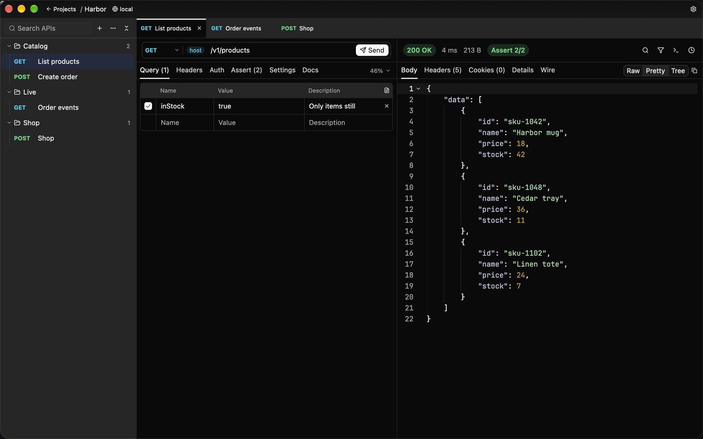
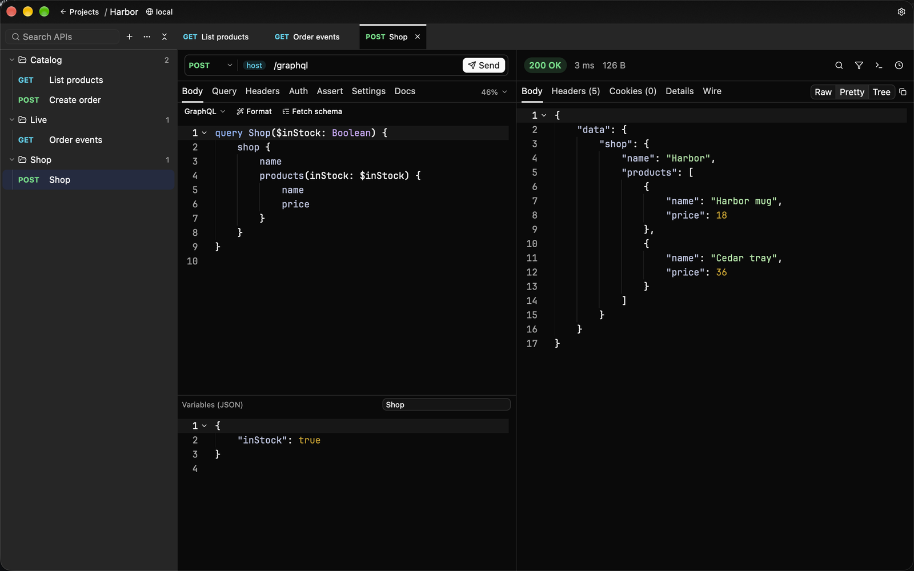
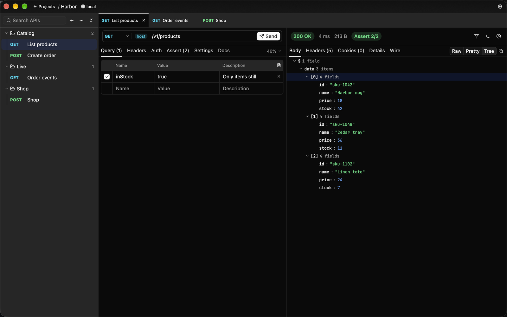
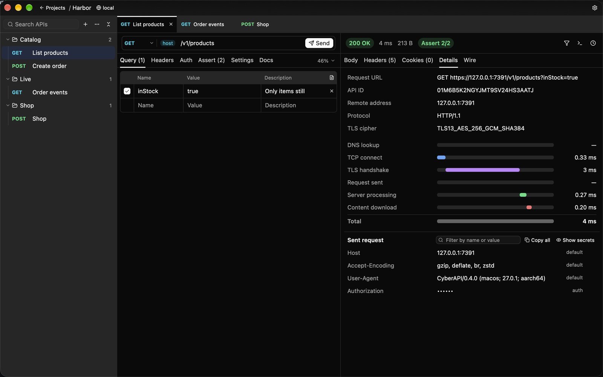

[中文](./GALLERY_zh.md) | English

# Gallery

The desktop app, in English. The same pictures are on the [README](../README.md).

## Workspace

A GET, the query value, two checks that passed, and the JSON body.

## Sending, events, and sync

https://github.com/user-attachments/assets/47018134-b823-40e1-93f5-a2047711a9c2

Send Create order and read the 201. Events show up as they arrive. Stop ends the stream and keeps what already came. Sync from the project's OpenAPI document adds Get a product, and the query value that was already filled in stays.

## GraphQL

## JSON tree

## Timings

DNS, TCP, TLS, the server and the download, each on its own. The request as it went out is underneath, and the auth header is masked.
