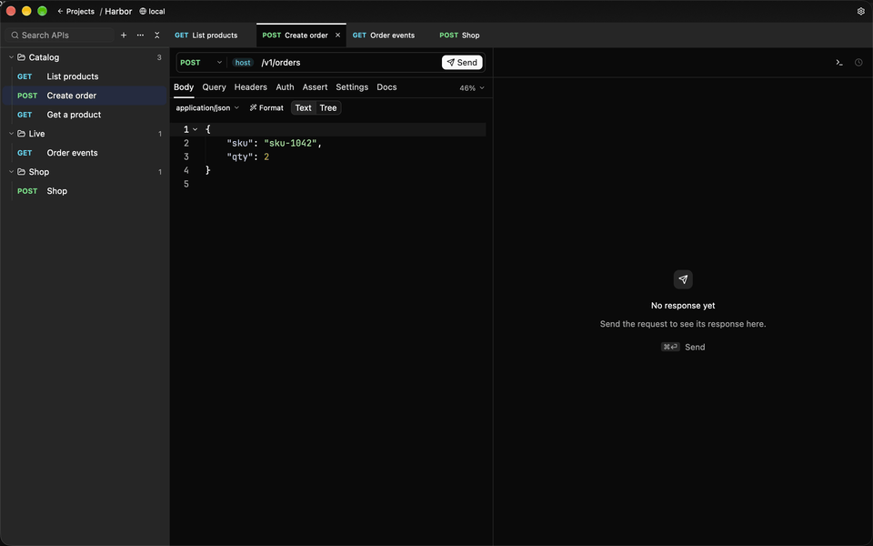
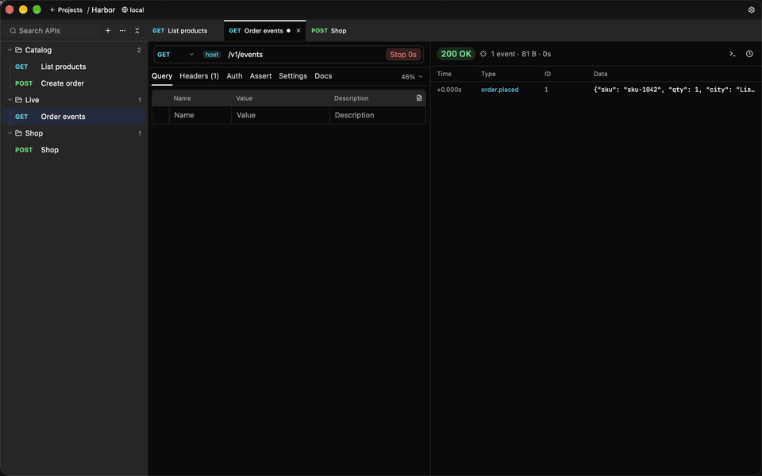
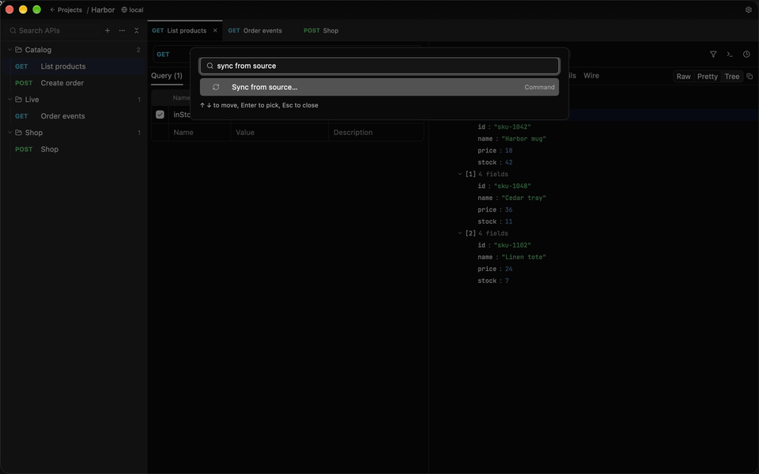

[中文](./GALLERY_zh.md) | English

# Gallery

The desktop app, in English. The same pictures are on the [README](../README.md).

## Workspace

A GET, the query value, two checks that passed, and the JSON body.

## Sending

## Event stream

Events show up as they arrive. Stop ends the stream and keeps what already came.

## Sync from a source

Sync from the project's OpenAPI document. The tree gains Get a product, and the query value that was already filled in stays.

## GraphQL

## JSON tree

## Timings

DNS, TCP, TLS, the server and the download, each on its own. The request as it went out is underneath, and the auth header is masked.
