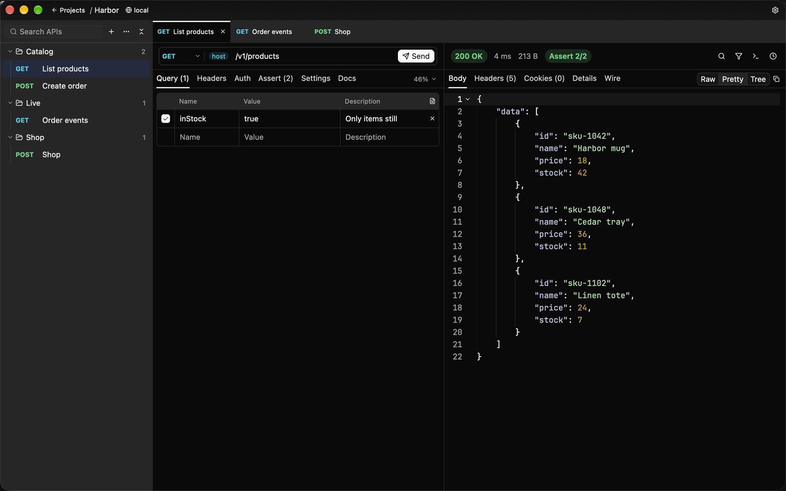
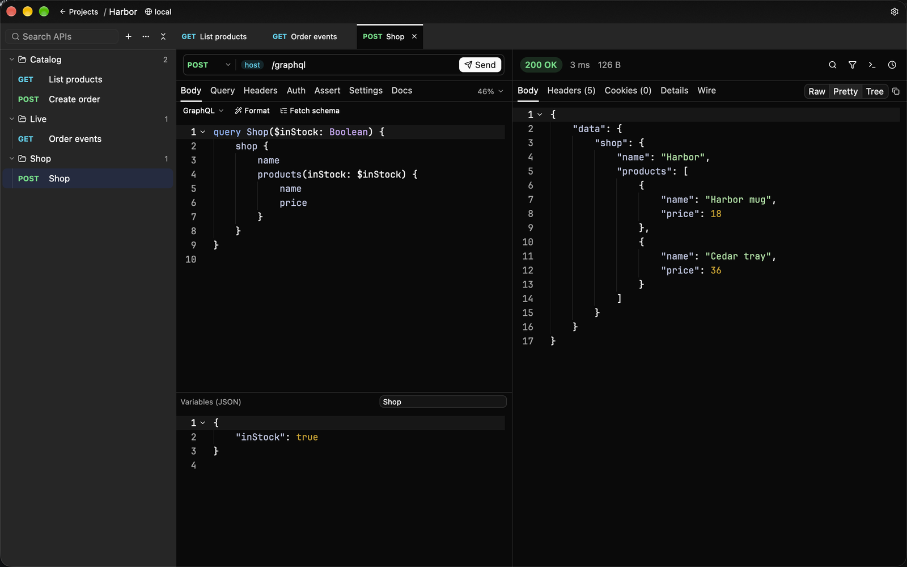
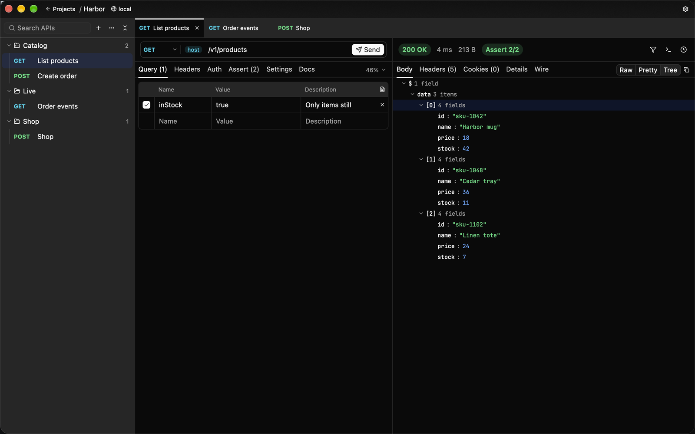
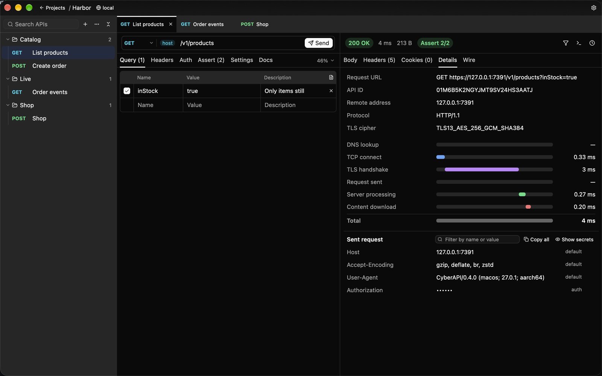

中文 | [English](./GALLERY.md)

# 图集

桌面版，界面为英文。同样的图在 [README](../README_zh.md) 上。

## 工作区

一次 GET、查询参数的值、两条通过的检查，以及 JSON 正文。

## 发送、事件流、从来源同步

https://github.com/user-attachments/assets/47018134-b823-40e1-93f5-a2047711a9c2

发送创建订单，读到 201。事件边到边出现。停止会结束这条流，已经收到的留下。按项目的 OpenAPI 文档同步后，树里多了 Get a product，原先填好的查询参数值还在。

## GraphQL

## JSON 树

## 耗时

DNS、TCP、TLS、服务器和下载各占一段。下面是实际发出的请求，认证头已打码。
